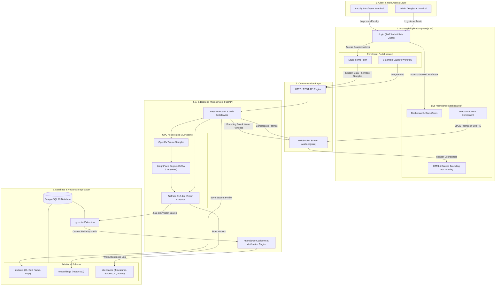

# Frontend Folder Structure

```
frontend/
├── app/
│   ├── layout.tsx             # Root layout with Sidebar and Top Navigation
│   ├── page.tsx               # Main Dashboard (Live Attendance Stream & Recent Logs)
│   ├── enroll/
│   │   └── page.tsx           # Student Face Enrollment Portal
│   ├── students/
│   │   └── page.tsx           # Registered Students Directory & Profiles
│   └── attendance/
│       └── page.tsx           # Historical Logs, Filtering & CSV Export
├── components/
│   ├── ui/                    # Reusable shadcn/ui buttons, tables, dialogs
│   ├── LiveCameraFeed.tsx     # Webcam + HTML5 Canvas Bounding Box Overlay
│   ├── AttendanceTable.tsx    # Live updating attendance table
│   └── EnrollmentCamera.tsx   # Capture step component for face samples
├── lib/
│   └── websocket.ts           # WebSocket connection manager for backend streams
└── package.json
```


### System Architecture

```
                 ┌─────────────────────────┐
                 │   Enrollment Website    │
                 │                         │
                 │  Admin/Enrollment only  │
                 │  Student registration   │
                 └────────────┬────────────┘
                              │
                              │ FastAPI
                              ▼
                       ┌─────────────┐
                       │   Database  │
                       └─────────────┘
                              ▲
                              │ FastAPI
                              │
                 ┌────────────┴────────────┐
                 │ Attendance Tracking Web │
                 │                         │
                 │ Professor Login         │
                 │ Live Camera             │
                 │ Attendance Dashboard    │
                 │ Logs / Export           │
                 └─────────────────────────┘
```

